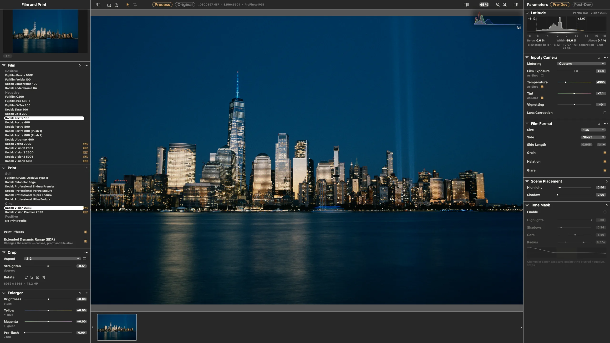
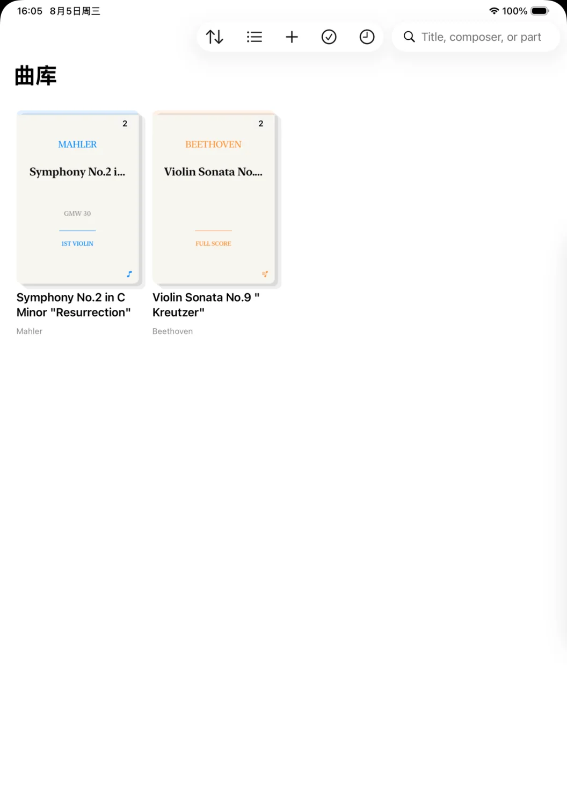
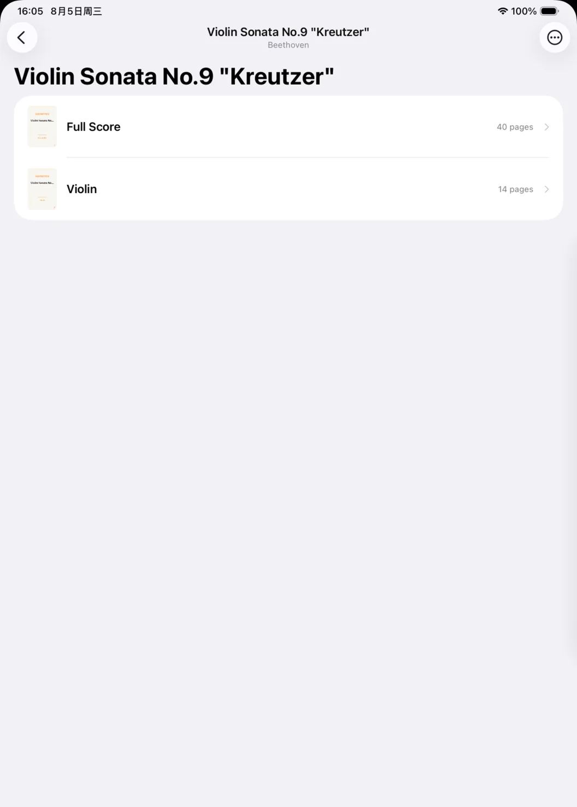
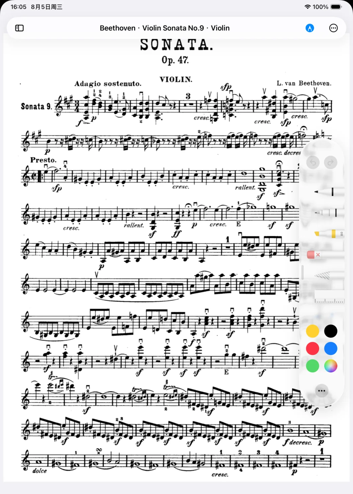
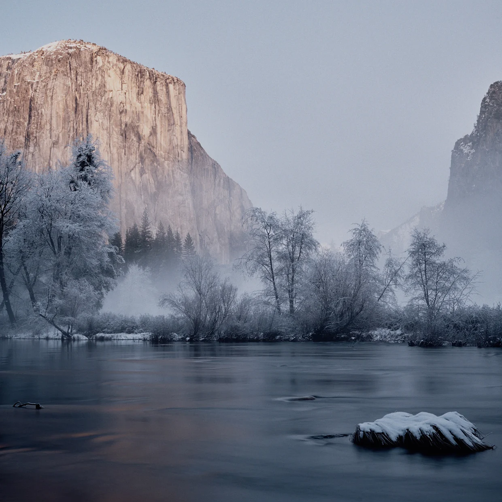
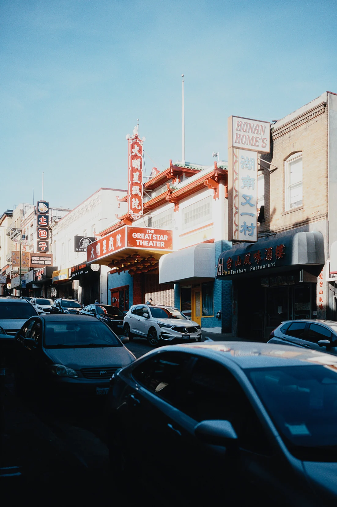

# Hanze Qiu 邱瀚泽

AI code artist · NYU Shanghai, class of 2027 · open to 2027 new-grad roles

**I take products all the way: from an open question, through specification and engineering, to a shipped release and the people who use it.**

[Portfolio and case studies (中文)](https://jamesqiu2005.github.io) · [hq2144@nyu.edu](mailto:hq2144@nyu.edu)

## Work

### SpektraLab

**Simulate the process of film, not its look.**

A film and print simulator for macOS. The open-source spectral model it builds on is physically accurate but runs as a Python command line, about 30 s per 45 MP image; SpektraLab makes it an app: open a RAW, pick a film and a paper, and get the print in about a second. I took it from product definition to launch on my own.

- **1.13 s** per 45 MP render, against about 30 s for the reference implementation
- **13.7 GB** peak memory at 102 MP, down from 27.4 GB in the first release
- **561** tests, **30** RFCs and **15** releases in 21 days
- **789** downloads on GitHub Releases (14 October 2026) and **1,000+** interactions on Xiaohongshu over the launch weekend

<a href="https://www.star-history.com/#JamesQiu2005/SpektraLab&Date">
  <picture>
    <source media="(prefers-color-scheme: dark)" srcset="https://api.star-history.com/svg?repos=JamesQiu2005/SpektraLab&type=Date&theme=dark">
    <source media="(prefers-color-scheme: light)" srcset="https://api.star-history.com/svg?repos=JamesQiu2005/SpektraLab&type=Date">
    
  </picture>
</a>

The film model, the 28 measured film and paper profiles and the enlarger LUTs come from Andrea Volpato's [spektrafilm](https://github.com/andreavolpato/spektrafilm) (GPLv3; profile data CC BY-SA 4.0). SpektraLab is its native C++ and Metal port and the app built around it.

SwiftUI · Metal · C++20 · macOS 15+ — [Repository](https://github.com/JamesQiu2005/SpektraLab) · [Download](https://github.com/JamesQiu2005/SpektraLab/releases/latest) · [spektralab.app](https://spektralab.app) · [Case study (中文)](https://jamesqiu2005.github.io/work/spektralab.html)

### Bowmark

**Organised around works, read for performance.**

An iPad score reader and annotator that came out of my own orchestra rehearsals as a violinist, and is now used in that orchestra. It turns scattered PDFs into works, movements and parts, and rebuilds the reader for the music stand. The key call was cutting optical music recognition, so it was usable on the stand right away.

Swift 6 · SwiftUI · PencilKit · iPadOS 18+ — [Repository](https://github.com/JamesQiu2005/Bowmark) · [Case study (中文)](https://jamesqiu2005.github.io/work/bowmark.html)

### Reggia

**Memory curated by the person, read by the agent on demand.**

A personal AI front end with no vector store. The user keeps their own context; the agent reads a ~100-token index first and a 5K–30K-token page only when needed, through 6 read-only tools in a ReAct loop capped at 8 rounds, and can always say what it read.

FastAPI · SQLite · Notion API — [Repository](https://github.com/JamesQiu2005/reggia) · [Case study (中文)](https://jamesqiu2005.github.io/work/reggia.html)

### Internal AI tooling

**Deciding what should go to agents, and what shouldn't.** AI Native intern reporting to the CEO at an early-stage tech company, 2026.07 – 09.

- Stopped a negative-return in-house multi-agent framework, with reproducible evidence of semantic deadlocks
- Wrote the standard for which work goes to agents across 3 departments: over 60% less time on one class of task, about 8 person-hours saved a week
- Led the requirements and permissions of an internal LLM gateway, and shipped four internal tools in five weeks

[Case study (中文)](https://jamesqiu2005.github.io/work/internal-ai-systems.html), de-identified.

## Practice

I keep the judgement; agents do the execution. Every product runs the same loop: find the **gap** in a real situation, **define** what not to build, **specify** one RFC per technical decision, **build** with parallel agents in isolated worktrees, **accept** against reference diffs, performance baselines and screenshots of the real window, then **ship** and iterate on what users report.

## Experience

- **2026.07 – 09** · an early-stage tech company · AI Native intern, reporting to the CEO
- **2025.05 – 08** · Bridgestone China · IT and Finance intern; built an LLM market-intelligence pipeline that went into use
- **2023.09 – 2027.05** · NYU Shanghai · B.S. Data Science (AI track), minor in Economics; violinist in the school orchestra

## Photography

I have taken photos since I was seven, on digital and medium-format film, with time in the darkroom. In SpektraLab that matters less for taste than for judgement: whether a result is physically right.

Nan'ao Island, Yosemite, San Francisco. Shot by me, developed in SpektraLab.

## Also

- [BetterRemoteDisplay](https://github.com/JamesQiu2005/BetterRemoteDisplay): a macOS menu bar app that gives a remote Mac's display the resolution of an Apple device, in HiDPI
- [CASED](https://github.com/JamesQiu2005/CASED_competition): technical lead on multimodal student-engagement detection for the ICMI 2026 Grand Challenge
- Glaucoma meta-analysis: second author

## Contact

[hq2144@nyu.edu](mailto:hq2144@nyu.edu) · résumé on request
